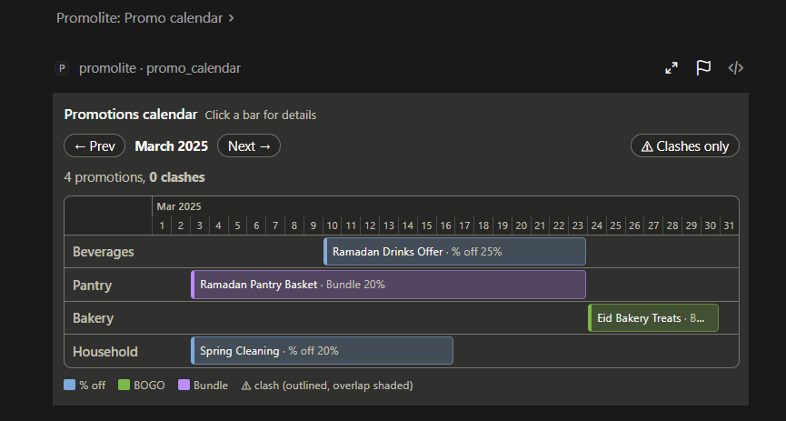
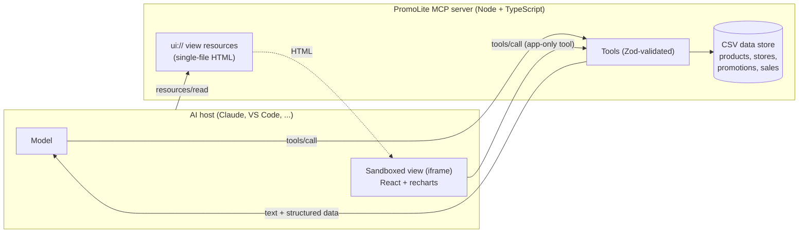

# PromoLite MCP


**An MCP server that lets an AI assistant analyse retail promotions, and answer with interactive views (sortable table,
trend chart, product picker, promotions calendar with clash detection) instead of walls of text.**

<!-- TODO: replace with the demo GIF (40-60 s): docs/demo.gif -->
<!--  -->

<p align="center">
  
</p>

## Try it in Claude in 30 seconds

> **Public URL:** `https://promolite.duckdns.org/mcp`

1. In Claude, open the connector settings and choose **Add custom connector**.
2. Paste the URL above.
3. Start a chat, enable the connector and ask: **"Which promotions clash in June 2025?"**

(No public URL? Run it locally, see [Quick start](#quick-start).)

## Why it exists

A miniature of an AI agent for promotion analytics, with interactive answers through
[MCP Apps](https://modelcontextprotocol.io). It is a learning and portfolio project, built on **synthetic data**, and is
not affiliated with any company or product.

A *promotion clash* is two promotions on the same category, in the same region (or one of them "all regions"), that
overlap by at least one day (inclusive). The server finds them for you.

## Features

- **Five model-visible tools**: `top_promotions`, `sales_trend`, `search_products`, `pick_products`, `promo_calendar`
  (plus a `ping` tool for connection checks).
- **Four interactive views** (MCP Apps, shown inside the chat): ranked table, trend chart with promo weeks shaded,
  product picker, calendar with clashes marked.
- **An app-only tool** (`search_products_ui`): the picker calls the server directly while you type; it is hidden from the
  model.
- **Honest uplift**: measured against a *clean baseline* (last 4 weeks with no promotion in the same category and region),
  not against a naive average that other promotions pollute.
- **Clash detection** with a precise, tested definition.
- **Theming**: views follow the host's light/dark theme and CSS variables.
- **Text fallback**: every tool also returns a complete text answer plus structured data, so hosts without MCP Apps
  support still get a useful result.
- **Shared components on two surfaces**: the same React components run inside AI hosts and in a standalone web panel
  (`npm run dev:panel`).
- **Strict CSP**: each view is one self-contained HTML file and declares a policy that allows no network access.

## Architecture



Production deployment: `client -> Nginx (limits, headers) -> app (Node, Streamable HTTP, stateless)`.

## Quick start

Requires Node 22+ (and Docker for the container route).

**Docker (server behind Nginx):**

```bash
docker compose up --build
# MCP endpoint: http://127.0.0.1:8080/mcp     health: http://127.0.0.1:8080/health
```

**Without Docker:**

```bash
npm ci
npm run build
npm run start:http        # http://127.0.0.1:3000/mcp
```

Use `127.0.0.1`, not `localhost` (some clients resolve `localhost` to IPv6 first).

**Claude Desktop (local, stdio):** build first (`npm run build`), then add this to `claude_desktop_config.json` with the
absolute path of your clone ([example file](docs/claude_desktop_config.example.json)):

```json
{
  "mcpServers": {
    "promolite": {
      "command": "node",
      "args": ["/absolute/path/to/PromoLite-MCP/dist/server/stdio.js"]
    }
  }
}
```

**MCP Inspector:** `npm run inspect` (Streamable HTTP: `http://127.0.0.1:8080/mcp` or `:3000/mcp`). Note that the
Inspector does not implement the hand-back calls (see below).

Full deployment guide, including a public HTTPS URL: [docs/DEPLOY.md](docs/DEPLOY.md).

## Testing

```bash
npm test          # builds the views, then runs the whole suite
npm run typecheck
npm run smoke     # calls every tool over stdio
```

About 160 tests in three layers: pure logic (data, uplift, clash detection, calendar layout), protocol tests (a real
MCP client against the real server, in memory), and component tests (Testing Library). Fixtures with known answers
protect the uplift calculation; the HTTP layer has its own tests (Host, Origin, rate limit, body limit). CI runs
typecheck, build and tests on every push (badge above).

## Security

There is **no authentication**: the data is synthetic and every tool is read-only. Layers that do exist (Nginx limits,
Host/Origin checks, rate limit, input validation, container hardening, strict CSP) and what is out of scope are in
[SECURITY.md](SECURITY.md).

## Compatibility

MCP Apps support differs between hosts. Observed so far (a full, dated report with screenshots is in progress):

| Host | Tools | Views render | Notes |
| --- | --- | --- | --- |
| Claude Desktop | yes | yes | Tested locally (stdio). |
| basic-host (MCP Apps reference) | yes | yes | Views, app-only tool and CSP behaviour verified in a browser. |
| MCP Inspector (v2.15) | yes | no | No `sendMessage` / `updateModelContext`: the picker shows a copy box instead. |
| claude.ai, VS Code, Cursor, ChatGPT, Gemini | - | - | Not tested yet. |

<!-- TODO: link docs/COMPATIBILITY.md when written, and expand this table with dates and versions -->

Where views are not supported, the server degrades gracefully: the text answer is complete on its own.

## Limits and next steps

- No authentication. Next step: OAuth 2.1 in front of `/mcp` (the SDK ships the building blocks).
- Synthetic, read-only data held in memory from CSV files; no database.
- Dependency scanning (Dependabot / `npm audit` in CI) is not set up yet.
- Compatibility has been tested on a subset of hosts only.

## Project layout

```
src/server/   MCP server (tools, schemas, data layer, HTTP app, stdio entry)
src/views/    the four views + shared React components
src/panel/    standalone web panel using the same components
scripts/      data generator, view build, stdio smoke test
tests/        Vitest suites and fixtures
docker/       Dockerfile and Nginx config
docs/         deployment guide, config example, screenshots
```

## License

ISC (see `package.json`). <!-- TODO: add a LICENSE file (the plan suggests MIT) -->
